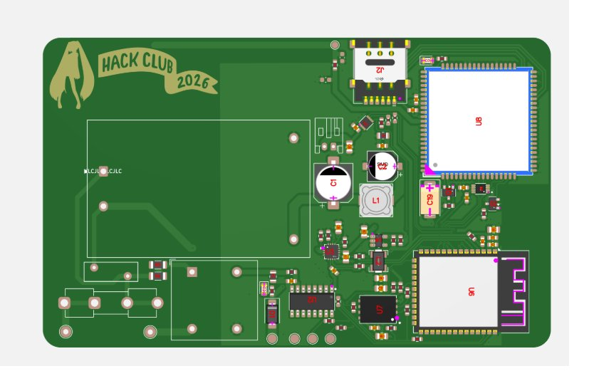
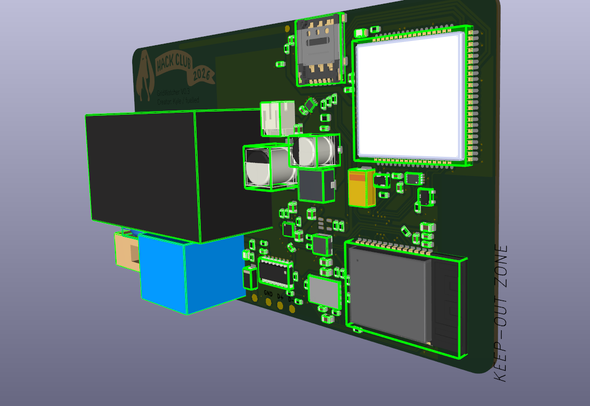
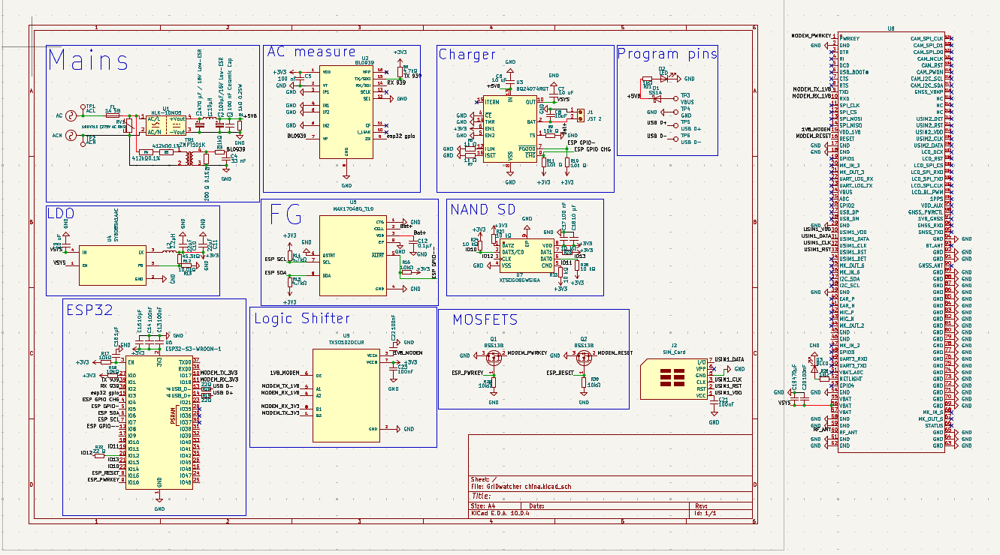
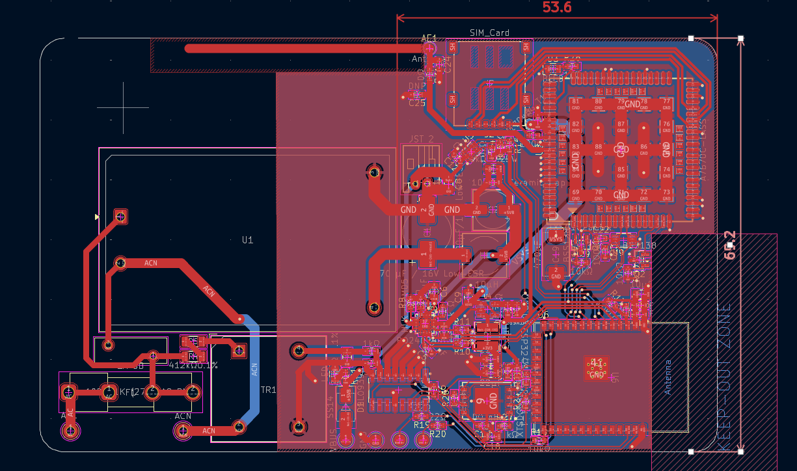

# GridWatcher (v0.3 / "GriDwatcher china")

> An edge electrical grid telemetry device that monitors AC line fluctuations and predicts power outages 20 to 60 seconds before they happen, sending alerts over 4G LTE cellular. Built for **Hack Club Fallen** (Maker Faire Shenzhen, Dec 2026).



**Author:** Kyle Mason Richter (`@fuelled` on Hack Club Slack / `kylerichter36-coder` on GitHub)  
**Target:** Hack Club Fallen — Maker Faire Shenzhen (Dec 11–14, 2026)  
**Hardware Repo:** [https://github.com/kylerichter36-coder/GridWatcher](https://github.com/kylerichter36-coder/GridWatcher)  
**BOM:** [bom.csv](bom.csv) (Includes links and pricing for every single part)  
**3D CAD Assembly:** [GriDwatcher_china_v0.3.step](Hardware/GridWatcher_v0.3/GriDwatcher_china_v0.3.step)  

---

## Why I Built This

If you live in South Africa like me, you already know the problem: our power grid is completely broken. Between rolling blackouts (load shedding), localized substation cable theft, and sudden breaker trips, our electricity cuts out all the time without any warning. These sudden drops corrupt computers, kill power supplies, and leave households stranded in the dark.

Most commercial energy monitors are totally reactive—they only text you *after* the power is already dead. But power grids dont just vanish instantaneously: before an electrical feeder collapses, the system exhibits measurable micro-fluctuations (sub-hertz frequency jitter, voltage sag gradients, and harmonic noise). 

I built GridWatcher to measure these exact micro-fluctuations and predict outages **20 to 60 seconds before total power failure**, giving you time to save your work, shut down sensitive equipment, or switch over backup systems.

---

## 3D CAD Assembly & Physical Design

GridWatcher is designed as a monolithic 2-layer integrated PCBA (113.40 x 69.22 mm) that mounts cleanly inside a 3D-printed snap-fit wall enclosure. Zero loose devboards, zero breadboard jumper wires, and zero external USB ports that collect dust.



*Full 3D CAD STEP mechanical model available at [Hardware/GridWatcher_v0.3/GriDwatcher_china_v0.3.step](Hardware/GridWatcher_v0.3/GriDwatcher_china_v0.3.step).*

---

## How It Works (System Architecture)

```
[230V AC Mains] 
       │
       ├──> [Hi-Link HLK-10M05 5V SMPS] ──> [CLC Pi-Filter] ──> [BQ24074 PMIC] ──> [SY8089 3.3V Buck] ──> [ESP32-S3 Core]
       │                                                              │
       │                                                       [1S LiPo Battery]
       │                                                              │
       ├──> [ZMPT101K Transformer] ──> [BL0939 Dual-Channel Meter] ───┘ (MAX17048 Fuel Gauge)
                                                    │
                                             (UART Telemetry)
                                                    │
                                                    ▼
                                            [ESP32-S3 Compute]
                                                    │
                                   ┌────────────────┴────────────────┐
                                   ▼                                 ▼
                     [Layer 1: Deterministic Rules]    [Layer 2: Random Forest ML]
                     (Blackout / Surge / Sag / Normal) (0-100% Pre-Outage Risk Index)
                                   │                                 │
                                   └────────────────┬────────────────┘
                                                    ▼
                                   [TXS0102 Level Shifter (1.8V <-> 3.3V)]
                                                    │
                                     [SIMCom A7670E 4G LTE Modem]
                                                    │
                                            (MQTT & SMS Alerts)
```

1. **AC Power Delivery & Safety:** Mains electricity (100–240V AC) enters through a 1A slow-blow fuse and 10D471K metal oxide varistor (MOV) for lightning and surge clamping. An isolated Hi-Link HLK-10M05 AC-DC module steps mains down to 5V DC, followed by a CLC Pi-filter (470µF + 10µH + 100µF) to eliminate high-frequency switching ripple.
2. **Precision Metering:** A ZMPT101K potential transformer provides 4kV galvanic isolation between mains and low-voltage logic. The isolated AC wave is sampled by a dedicated Shanghai Belling BL0939 dual-channel energy measurement IC, calculating hardware true RMS voltage, active current, power factor, and line frequency.
3. **Uninterruptible Power Path:** A Texas Instruments BQ24074 PMIC routes system power directly from mains while charging an external 1S Li-ion battery. If mains collapses, it switches system rails to battery power instantaneously with zero drop-out. A Maxim MAX17048 I2C fuel gauge tracks real-time battery percentage.
4. **Compute & Machine Learning:** An ESP32-S3-WROOM-1-N16R8 runs a dual-layer classification engine. Layer 1 executes a deterministic C++ state machine; Layer 2 feeds rolling 10s and 30s feature buffers ($dV/dt$, $dF/dt$, $V_{std}$, $F_{std}$, $V_{slope}$) into an embedded Random Forest decision tree model (`grid_model.h`) to compute pre-outage risk scores (0–100%).
5. **Direct 4G Cellular Link:** When risk exceeds 70% or power drops, a SIMCom A7670E Cat-1 LTE modem transmits telemetry packets over MQTT and dispatches emergency SMS alerts directly to your phone—independent of local Wi-Fi or home routers which die during blackouts!
6. **Black-Box Flash Waveform Storage:** An industrial 1GB SD-NAND flash chip (`XTSDG08GWSIGA`, LGA-8) sits on an SDMMC bus, recording raw high-speed electrical waveforms before and after trip events for post-incident power quality analysis.

---

## Schematic (10 Functional Blocks)

The schematic is organized into 10 modular functional blocks in KiCad 10:



1. **Mains Input & Protection:** Fuse, MOV, Hi-Link 5V SMPS, ZMPT101K potential transformer.
2. **AC Measure:** Shanghai Belling BL0939 dual-channel energy IC with precision 412k voltage divider.
3. **Charger:** TI BQ24074 dynamic power-path manager and 1.0A Li-ion charger.
4. **Program Pins:** 4 gold flush pogo-pin pads (VBUS, GND, D+, D-) with SS14 reverse-power isolation diode.
5. **LDO / Buck:** Silergy SY8089A1AAC 2A 1.5MHz synchronous step-down converter for 3.3V system logic.
6. **Fuel Gauge:** Maxim MAX17048 I2C battery state-of-charge IC.
7. **NAND SD:** XTX 1GB SD-NAND LGA-8 flash chip with 5x 10k pull-ups and 22Ω clock damping resistor (`R22`).
8. **Logic Shifter:** TI TXS0102DCUR bidirectional level translator (1.8V cellular baseband <-> 3.3V MCU).
9. **MOSFETs:** Dual onsemi BSS138 N-channel FET switches for modem PWRKEY and RESET lines.
10. **Cellular Modem:** SIMCom A7670E 4G LTE Cat-1 baseband, hinged Nano-SIM socket, and 470µF tantalum buffer.

---

## PCB Layout & Routing

The PCB was designed and routed in KiCad as a 2-layer FR-4 board measuring **113.40 x 69.22 mm**:



### Key Layout Considerations:
* **High-Voltage Creepage & Clearance:** 230V AC Live and Neutral copper traces are routed with >3.5 mm physical separation and routed away from all 3.3V digital signals.
* **RF Keep-Out Zone:** An etched copper trace antenna sits on the top edge with zero copper planes underneath (hatched keep-out area) to maintain 50Ω impedance matching.
* **Transient GSM Decoupling:** A 470µF low-ESR tantalum capacitor (`C19`) sits directly beside the A7670E VBAT pins to supply 2.0A transmission burst pulses without triggering undervoltage lockouts.
* **High-Frequency Bypass Placement:** 100nF ceramic decoupling caps sit directly adjacent to ESP32 VDD pins and SD-NAND VCC pins, tied into the bottom ground plane with dedicated vias.

---

## Bill of Materials (BOM)

The complete Bill of Materials with supplier links and prices is available in [bom.csv](bom.csv).

### Summary Breakdown:

| Category | Description | Sourcing | Cost (USD) | Cost (ZAR) |
| :--- | :--- | :--- | :---: | :---: |
| **JLCPCB SMT Order** | 2 Assembled PCBAs (Top SMT) + 5 Bare 2-Layer PCBs + Courier Delivery | JLCPCB | $327.45 | R 5,959.59 |
| **Hand-Soldered THT Parts** | Hi-Link SMPS, ZMPT101K transformer, MOV, 1A fuse, JST-PH battery header | LCSC / Local | $15.00 | R 273.00 |
| **Diagnostic Tool** | FNIRSI DSO153 Pocket Mini-Oscilloscope (Bare-minimum tool for AC safety) | Takealot | $65.30 | R 1,189.00 |
| **Self-Owned ($0)** | 1S 3.7V Li-ion battery, 3D printed enclosure, pogo jig, soldering tools | Reused | $0.00 | R 0.00 |
| **Total Project Funding** | **Hack Club Grant Funding Request** | **HCB Card** | **$407.75** | **R 7,421.59** |

*(Calculated at 1 USD = ~18.20 ZAR)*

---

## Firmware Architecture & Driver Skeleton

Because the physical boards are currently in manufacturing at JLCPCB, I obviously cannot flash or debug low-level hardware registers until the physical PCBAs arrive on my desk! 

However, the complete firmware architecture and FreeRTOS task structure is already implemented in [firmware/firmware.ino](firmware/firmware.ino):

```
firmware/
├── firmware.ino          # Modular FreeRTOS driver architecture & task scheduler
├── grid_model.h          # Exported Random Forest C++ decision tree ensemble
└── secrets.h.example     # Network configuration template
```

### FreeRTOS Modular Tasks:
1. `Task_EnergyMetering`: UART driver reading registers from the Shanghai Belling BL0939 (Voltage RMS, Current RMS, Frequency).
2. `Task_PredictionEngine`: Evaluates instantaneous Layer 1 rules and computes rolling rates of change ($dV/dt$, $dF/dt$, $V_{std}$) feeding `grid_model.h` to generate pre-outage risk scores (0–100%).
3. `Task_CellularTelemetry`: Controls the SIMCom A7670E via AT commands over level-shifted UART, publishing periodic MQTT telemetry and dispatching emergency SMS alerts during predicted grid failure.
4. `Task_BlackboxStorage`: SDMMC driver writing continuous high-speed waveform data buffers to the 1GB SD-NAND flash chip.
5. `Task_PowerManagement`: Polls the MAX17048 fuel gauge over I2C and monitors the BQ24074 `CHG` status pin.

---

## Repository Structure

```
GridWatcher/
├── Hardware/
│   └── GridWatcher_v0.3/             # Bespoke monolithic PCBA design files
│       ├── GriDwatcher china.kicad_pcb  # KiCad PCB layout (113.40 x 69.22 mm)
│       ├── GriDwatcher china.kicad_sch  # Complete 10-block schematic
│       ├── GriDwatcher china.kicad_pro  # KiCad project definition
│       ├── GriDwatcher china.kicad_prl  # KiCad local settings
│       ├── GriDwatcher_china_gerbers.zip# RS-274X manufacturing Gerbers & drill files
│       ├── GriDwatcher_china_v0.3.step  # 3D mechanical CAD assembly model
│       ├── jlcpcb_bom.csv            # Pick-and-place BOM for JLCPCB
│       ├── jlcpcb_cpl.csv            # Pick-and-place centroid coordinate file
│       └── bom.csv                   # Comprehensive BOM with parts links
├── docs/                             # Project screenshots & visual assets
│   ├── 3d_cad_assembly.png           # 3D CAD mechanical render
│   ├── pcb_render_top.jpg            # 3D top board render with Hack Club silkscreen
│   ├── pcb_routing.png               # KiCad 2-layer routing with dimensions
│   └── schematic_10blocks.png        # Complete 10-block functional schematic
├── firmware/                         # Microcontroller firmware skeleton & ML model
│   ├── firmware.ino                  # FreeRTOS driver structure & task scheduler
│   ├── grid_model.h                  # Compiled Random Forest decision trees
│   └── secrets.h.example             # Credential configuration template
├── windows_trainer/                  # Python machine learning retraining pipeline
│   ├── gridwatcher_ml_gui.py         # Rolling feature extraction & C++ exporter
│   └── simulate_ml_brain.py          # Synthetic grid failure training simulation
├── bom.csv                           # Root BOM with links and pricing for every item
├── JOURNAL.md                        # Detailed engineering build log & session notes
└── README.md
```

---

## Next Steps for Build Submission

1. **Receive Manufactured PCBAs:** Receive assembled boards from JLCPCB.
2. **Hand Solder Through-Hole Components:** Solder Hi-Link SMPS, ZMPT101K transformer, MOV, fuse holder, and JST battery connector.
3. **Probe & Verify with Oscilloscope:** Scope the ZMPT101K transformer secondary winding to verify safe AC amplitude scaling, check SD-NAND clock damping, and observe buck switching stability under 2A cellular pulses.
4. **Tune Low-Level Registers:** Finalize BL0939 UART register offsets and calibrate against a reference multimeter.
5. **3D Print Enclosure & Field Deploy:** Snap board into the 3D-printed case, mount next to the household distribution board, and record live grid telemetry for the Shenzhen demo!
